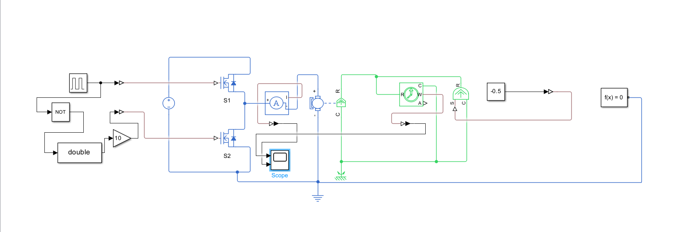
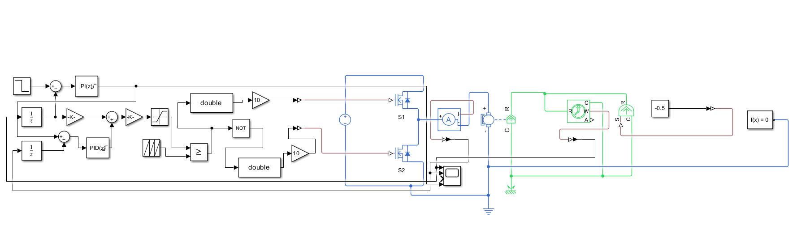
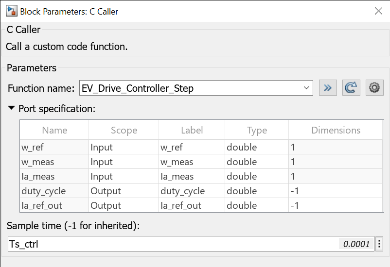
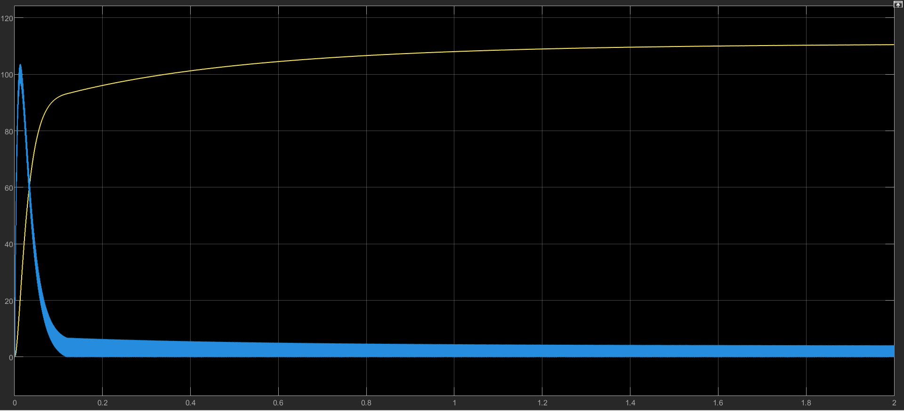
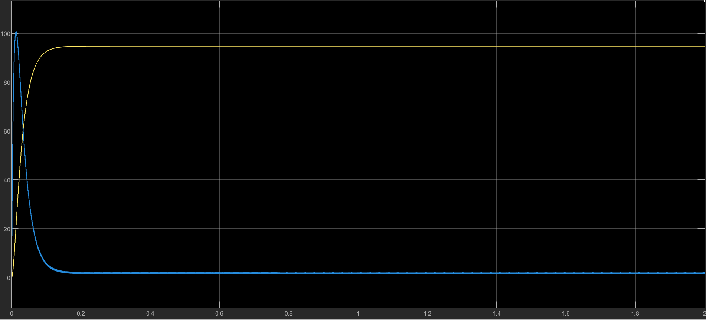
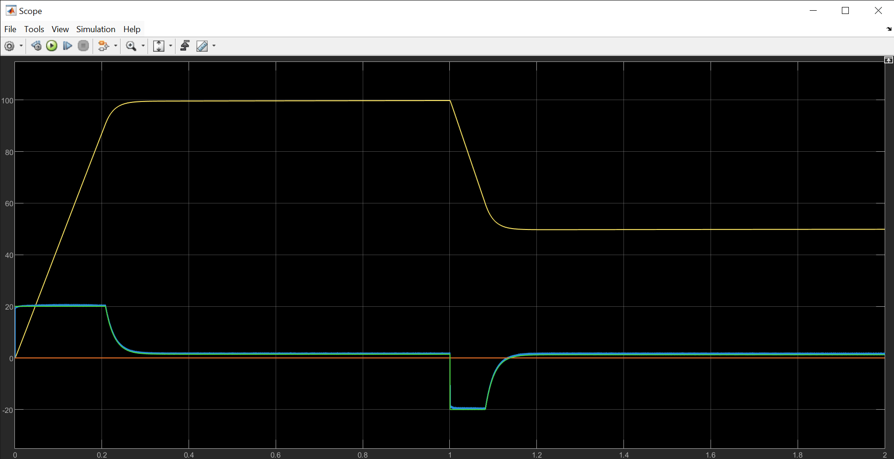

# Speed-Controlled Two-Quadrant DC Motor Drive with Regenerative Braking

**Digital Twin & Cascaded Control Architecture**

This repository contains a high-fidelity digital twin of a 48V, 500W Electric Vehicle (EV) powertrain. Built using MATLAB/Simulink (Simscape Electrical), the project models both the physical electromechanical plant and a discrete-time cascaded controller to achieve seamless two-quadrant operation (Motoring and Regenerative Braking). The project was developed using a first-principles "Learn As You Build" (LAYB) methodology, bridging low-level hardware physics with rigorous discrete-time control theory.

## 1. Governing Differential Equations & Plant Physics

The digital twin's physical plant is mathematically grounded in the core electromechanical differential equations linking the electrical and mechanical domains.

**Electrical Domain (Kirchhoff's Voltage Law)**
The dynamic current through the motor's copper windings is governed by the applied terminal voltage, resistive heating losses, inductive smoothing, and the generated back-EMF:
$$V(t) = R_a i_a(t) + L_a \frac{di_a(t)}{dt} + E_b(t)$$

**Mechanical Domain (Newton's Second Law for Rotation)**
The rotational dynamics of the motor shaft are dictated by the electromagnetic torque generated, minus the inertial resistance to speed changes, viscous bearing friction, and the external road load:
$$T_m(t) = J \frac{d\omega(t)}{dt} + B\omega(t) + T_L(t)$$

**Electromechanical Coupling**
The two domains interface via the machine's flux constants. Electromagnetic torque is proportional to armature current, and back-EMF is proportional to rotor speed:
$$T_m(t) = K_t i_a(t)$$
$$E_b(t) = K_e \omega(t)$$

**Regenerative Braking Principle (Quadrant 2)**
By stepping the duty cycle down, the applied average voltage ($V$) drops below the motor's active back-EMF ($E_b$). According to the core current equation $I_a = \frac{V - E_b}{R_a}$, making $V$ smaller than $E_b$ instantly forces $I_a$ to become negative. This reverse current flow creates negative torque, actively decelerating the shaft while recharging the DC bus.

## 2. Model Parameters (48V, 500W PMDC Motor)

| Parameter | Symbol | Value | Unit | Description |
| :--- | :--- | :--- | :--- | :--- |
| **DC Bus Voltage** | $V_{bus}$ | $48$ | $\text{V}$ | Battery / Bus Voltage |
| **Armature Resistance** | $R_a$ | $0.25$ | $\Omega$ | Winding resistance |
| **Armature Inductance** | $L_a$ | $0.0015$ | $\text{H}$ | Winding inductance ($1.5\text{ mH}$) |
| **Rotor Inertia** | $J$ | $0.015$ | $\text{kg}\cdot\text{m}^2$ | Combined motor and load inertia |
| **Viscous Friction** | $B$ | $0.001$ | $\text{N}\cdot\text{m}\cdot\text{s/rad}$ | Damping coefficient |
| **Torque Constant** | $K_t$ | $0.35$ | $\text{N}\cdot\text{m/A}$ | Torque produced per Ampere |
| **Back-EMF Constant** | $K_e$ | $0.35$ | $\text{V/(rad/s)}$ | Voltage generated per rad/s |
| **Plant Sample Time** | $T_{s\_plant}$ | $10^{-6}$ | $\text{s}$ | Physical simulation step size ($1\ \mu\text{s}$) |
| **Ctrl Sample Time** | $T_{s\_ctrl}$ | $10^{-4}$ | $\text{s}$ | Embedded control execution step size ($100\ \mu\text{s}$) |

## 3. System Architecture & Embedded Control

**The Power Electronics Topology**



The power stage utilizes a Class B (Half-Bridge) Chopper with two active MOSFETs arranged vertically across the 48V DC bus. This synchronous topology allows bidirectional current flow. The physical Simscape network evaluates at a high-frequency $1\ \mu\text{s}$ sample rate to capture real-world hardware transients.

**Cascaded Control & Native Discrete PI Implementation**



To control the physical plant while protecting the hardware, the system employs a dual-loop cascaded architecture running at a strict 10 kHz ($100\ \mu\text{s}$) discrete sample rate. Built entirely with native Simulink discrete blocks to bypass external compiler constraints, the architecture ensures absolute mathematical fidelity:
*   **Outer Speed Loop:** Compares target speed against measured speed and outputs a current command.
*   **Anti-Windup Clamping:** The outer speed PI block restricts the current output to $\pm 20\text{ A}$ (utilizing active clamping) to protect the plant from extreme inrush currents and prevent mathematical integrator windup.
*   **Inner Current Loop:** Rapidly tracks the requested current and calculates the necessary voltage adjustment to regulate torque and protect the MOSFETs.
*   **Back-EMF Feedforward:** To decouple motor speed from the current controller, the measured speed is multiplied by $K_e$ ($0.35$) to estimate the motor's active back-EMF. This value is injected directly into the control voltage, relieving the inner loop from chasing mechanical speed transients.
*   **PWM Normalization:** The commanded voltage is normalized against the 48V bus and passed through a 0-1 Saturation block to synthesize the final 10 kHz complementary PWM logic.

**Hardware-in-the-Loop (HIL) Readiness**



The repository also includes the bare-metal C firmware (`ev_controller.c`) and demonstrates the C Caller port configuration, verifying that the control logic can be directly compiled into embedded microcontrollers for physical prototyping.

## 4. Engineering Diagnostics & Validation

**Phase 1: Overcoming Discontinuous Conduction Mode (DCM)**



During initial open-loop testing with a 70% duty cycle, the plant exhibited an artificial speed drift up to 110 rad/s. Diagnostic telemetry revealed the armature current clipping flat at 0 A with a distinct kink in the speed curve at $t = 0.12\text{ s}$. This was traced to an under-driven gate signal on the synchronous rectifier, trapping the motor in Discontinuous Conduction Mode (DCM) and inflating the average terminal voltage. 



Correcting the complementary logic to deliver a full 10V gate drive forced the drive into continuous conduction, eliminating the speed kink and locking the steady state perfectly to mathematical expectations.

**Phase 2: Closed-Loop Transient Performance & Anti-Windup**



The final digital twin was subjected to a dynamic two-quadrant step profile to validate the cascaded PI tuning and anti-windup configuration. During initial closed-loop tests, the speed loop exhibited a $+10\text{ rad/s}$ overshoot due to integrator windup accumulating during the 20 A physical current saturation phase. Activating the anti-windup clamping algorithm inside the discrete PI blocks completely eliminated this mathematical lag.
*   **Quadrant 1 Motoring ($0$ to $1.0\text{ s}$):** Commanded to accelerate to 100 rad/s, the inner current loop perfectly clamped the inrush transient at exactly $+20\text{ A}$. The integration of anti-windup clamping in the speed loop resulted in a pristine, zero-overshoot lock onto the target speed, seamlessly transitioning the current down to steady state.
*   **Quadrant 2 Regenerative Braking ($1.0\text{ s}$ to $2.0\text{ s}$):** At $t = 1.0\text{ s}$, the reference speed was stepped down to 50 rad/s. The controller instantly commanded maximum regenerative braking, snapping the armature current to $-20\text{ A}$, forcing kinetic energy back into the DC bus until the new target was reached.

## 5. Repository Organization

```text
EV-TwoQuadrant-Drive-DigitalTwin/
├── docs/                                      # Schematics and block diagrams
│   ├── c_caller_interface.png                 
│   ├── closed_loop_architecture.png           
│   ├── open_loop_ccm_validation.png           
│   ├── open_loop_dcm_anomaly.png              
│   └── open_loop_physical_plant.png           
├── results/                                   # Scope telemetry and performance graphs
│   └── closed_loop_cascaded_performance.png   
├── src/
│   ├── controller/
│   │   ├── ev_controller.c                    # Bare-metal C control logic (HIL ready)
│   │   └── ev_controller.h                    # C controller header
│   ├── init/
│   │   └── init_motor_parameters.m            # 48V, 500W plant parameters and constraints
│   └── plant/
│       ├── closed_loop_two_quadrant_drive.slx # Final cascaded native PI control model
│       └── two_quadrant_drive_plant.slx       # Open-loop physical plant for CCM testing
└── README.md

```
## 6. How to Run
1. Execute src/init/init_motor_parameters.m in MATLAB to load the workspace variables, PI gains, and sample times.

2. Open src/plant/closed_loop_two_quadrant_drive.slx.

3. Run the simulation to generate the final cascaded performance telemetry.